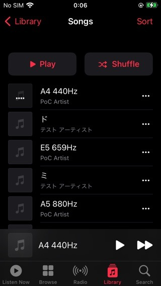

# homeshare-linux

A from-scratch **Apple "Home Sharing" server for Linux** that an iPhone / iOS
Music app discovers, authenticates against, browses, and **plays audio from** —
with no iTunes, no Apple binaries, and **no captured FairPlay data**.

This is a clean-room re-implementation derived from static analysis of the
Windows iTunes binary (Ghidra) and plaintext observation of the on-the-wire
protocol. It implements the parts the open-source world had not reached:
`_home-sharing._tcp` advertisement, `hsgid` login, the FairPlay SAP `/fp-setup`
handshake, and `/home-share-verify`.

> Status: **working end-to-end on real hardware** — iPhone SE (iOS 15.8.7)
> discovers the Linux library, passes FairPlay, lists songs, and streams audio.



## Why this is new

OwnTone/forked-daapd has long documented that *"Apple Home Sharing cannot be
supported"* and *"the iOS Music app uses Apple Home Sharing, which hasn't been
cracked."* The blocker was always the FairPlay `/fp-setup` step. This project
shows that, **for Home Sharing specifically, FairPlay SAP is only an
authentication ritual** and can be satisfied without any Apple cryptography.

## The key finding: FairPlay SAP is a no-op gate here

The `/fp-setup` handshake is 4 messages with a 12-byte header
(`FPLY` + version `02 01` + type + pad + big-endian length):

| Phase | Dir | Len | Payload |
|-------|-----|-----|---------|
| P1 | C→S | 16B | `02 00 <idx> bb` — **no client nonce** |
| P2 | S→C | 142B | `02 <idx>` + 128 bytes |
| P3 | C→S | 164B | 152-byte blob |
| P4 | S→C | 32B | 20 bytes = **echo of P3's last 20 bytes** |

Two facts make this trivial to satisfy on Linux:

1. **The client never validates P2.** Two genuine P2 responses captured from
   real iTunes share **0 of 128** blob bytes — the blob is pure per-session
   noise. P1 carries no client nonce, and Home Sharing streams media as plain
   HTTP, so the SAP-derived key is never used. We therefore **synthesize** P2 as
   `header + mode + idx + os.urandom(128)`. P4 is just an echo.
2. **`/home-share-verify` must return `204 No Content`.** Returning `200` makes
   the client treat the session as unverified and log out
   ("Unable to turn on Home Sharing").

No captured bytes ship in this repo. See [`docs/FAIRPLAY.md`](docs/FAIRPLAY.md)
for the full analysis and [`docs/PROTOCOL.md`](docs/PROTOCOL.md) for the rest
of the protocol.

## Minimal server contract (verified on device)

```
GET  /login                         -> 200  mlog{ mstt:200, mlid:<session> }
POST /fp-setup  (P1, type 0x01)     -> 200  FPLY 02 01 02 00 | 02 <idx> + random(128)
POST /fp-setup  (P3, type 0x03)     -> 200  FPLY 02 01 04 00 | echo last 20 bytes of P3
GET  /home-share-verify             -> 204  No Content           (critical)
GET  /databases                     -> 200  DMAP
GET  /databases/N/items/<id>.<ext>  -> 206  plain audio (HTTP Range)
```

`Client-Daap-Validation` headers ride on every client request; the server
ignores them (accept-all is sufficient).

---

# Usage

## 1. Requirements

- **Linux** with Python **3.9+**.
- **`avahi-daemon`** running (the server publishes Bonjour/mDNS over it via
  D-Bus). On Debian/Ubuntu: `sudo apt install avahi-daemon`.
- The iPhone and the Linux box must be on the **same LAN / subnet** (mDNS is
  link-local; it does not cross most VLANs or guest networks).
- Python deps from `requirements.txt`: `dbus-next` (Avahi over D-Bus),
  `mutagen` (read tags), `zeroconf` (`--learn` + `tools/mdns_check.py`).

## 2. Install

```bash
git clone git@github.com:nmt3325/open-HomeSharing.git homeshare-linux
cd homeshare-linux
python3 -m venv .venv && . .venv/bin/activate
pip install -r requirements.txt
```

## 3. Run it

**Try it with generated test tracks first** (sine tones with tags, no encoder
needed):

```bash
python tools/gen_testmusic.py testmusic
python -m homeshare.server --music testmusic --name "My Linux Library" --learn
```

**Point it at your own music** instead:

```bash
python -m homeshare.server --music ~/Music --name "My Linux Library" --learn
```

Supported files: **MP3, AAC/ALAC (.m4a), AIFF, WAV**. The server listens on
`[::]:3689` (dual-stack IPv4+IPv6) by default and logs one startup line:

```
[main] DAAP/HS on [::]:3689 tracks=42 hG=... state=/home/you/.local/state/homeshare/state.json
```

## 4. Connect from your iPhone

1. On the iPhone: **Settings → Music → Home Sharing**, and sign in with your
   Apple ID (this turns Home Sharing *on* on the client — the server cannot do
   this for you).
2. Make sure `hG` matches (see below). With `--learn`, the easiest path is: open
   **Music → Home Sharing** on the phone once while the server is running —
   that browse query leaks the account's `hG`, the server adopts it and
   re-advertises.
3. On the iPhone: **Music → (Library) → Home Sharing → _My Linux Library_**.
   Your tracks appear; tap one to stream.

> `hG` is the Home Sharing group id, derived from the Apple ID. A client only
> lists libraries whose `hG` matches its account, so the server must advertise
> the right one — that is what `--learn` / `--hsgid` are for (next section).

## 5. Matching the Home Sharing group (`hG`)

A client filters discovery by its own `hG`, so the server has to advertise a
matching value. Three ways, in order of convenience:

- **`--learn`** — sniff the LAN and adopt the first `hG` seen, either from
  another iTunes/Music library signed into the same account, or from the
  iPhone's own browse query. Once learned it is saved to `state.json`, so it
  only has to be seen once.
- **`--hsgid <hG>`** — set it explicitly if you already know the GUID (no
  sniffing needed; works even when no other device is online).
- Default (neither) — plain DAAP only; iOS Home Sharing will not list it.

To discover the `hG` values currently on your LAN:

```bash
python tools/mdns_check.py            # list _daap._tcp / _home-sharing._tcp
python tools/mdns_check.py <hG>       # also probe the _<hG>._sub subtype
```

## 6. Run as a service (systemd --user)

A ready unit is in [`systemd/homeshare.service`](systemd/homeshare.service)
(runs as your user, no root). Assuming the checkout is at `~/homeshare-linux`
and the venv at `~/homeshare-linux/.venv`:

```bash
mkdir -p ~/.config/systemd/user
cp systemd/homeshare.service ~/.config/systemd/user/
# edit --music / --name / flags in the unit to taste
systemctl --user daemon-reload
systemctl --user enable --now homeshare.service
loginctl enable-linger "$USER"        # keep running without an active login

journalctl --user -u homeshare.service -f      # follow logs
systemctl --user reload homeshare.service      # rescan the library (SIGHUP)
```

## 7. Verify & troubleshoot

**Full self-test (incl. FairPlay) without a phone** — in a second shell while
the server runs:

```bash
python tools/hsclient.py http://127.0.0.1:3689
# expect: "20/20 checks passed"
```

Common issues:

| Symptom | Likely cause / fix |
|---------|--------------------|
| Library not listed on the phone | `hG` mismatch — use `--learn` and open Home Sharing on the phone once, or pass `--hsgid`. Confirm with `tools/mdns_check.py`. |
| Nothing discovered at all | `avahi-daemon` not running, or phone/host on different subnets. mDNS is UDP **5353**. |
| "Unable to turn on Home Sharing" | `/home-share-verify` not returning **204**, or Home Sharing is off on the phone. |
| Connects but no audio | Open the media port: **TCP 3689** (or your `--port`) must be reachable from the phone. |
| Tags missing / all "Unknown" | Install `mutagen` (`pip install -r requirements.txt`); unsupported container. |

Logs go to `<state-dir>/hs.log` (default `~/.local/state/homeshare/hs.log`), or
to the journal under systemd.

## 8. Options

| Flag | Env | Meaning |
|------|-----|---------|
| `--music DIR` | `HS_MUSIC` | folder to share: MP3, AAC/ALAC (M4A), AIFF, WAV (default `/srv/music`) |
| `--name NAME` | `HS_NAME` | library display name (default `<hostname> Home Sharing`) |
| `--port N` | `HS_PORT` | HTTP port (default 3689) |
| `--hsgid GUID` | `HS_HSGID` | Home Sharing group id (`hG`) to advertise |
| `--learn` | | sniff the LAN and adopt the `hG` of the local Home Sharing group |
| `--no-mdns` | | don't publish via Avahi (for manual/offline testing) |
| `--state-dir DIR` | `HS_STATE_DIR` | where `state.json` + `hs.log` live (default `$XDG_STATE_HOME/homeshare`) |
| `--log FILE` | | log file (default `<state-dir>/hs.log`) |

`SIGHUP` (or `systemctl --user reload homeshare`) rescans the library.

Per-install identity (Machine ID, Database ID, MID, `hC`, learned `hG`) is
generated randomly on first start and kept in `state.json` in the state
directory — outside the source tree, so a checkout never carries anyone's
identity.

## Layout

```
homeshare/          the server (importable package)
  server.py           entry point (python -m homeshare.server), mDNS wiring
  handler.py          HTTP routing + FairPlay SAP + home-share-verify
  daap.py             session state, server-info / login / update builders
  daap_lists.py       databases / containers / items / groups (DMAP lists)
  daap_fields.py      song metadata field table
  dmap.py             DMAP tag encoder
  dmapdec.py          DMAP decoder (used by the test client)
  library.py          music scanner + pluggable backend interface
  mdns.py             Avahi publisher + passive mDNS sniffer
  hsconf.py           per-install identity + Bonjour TXT records
  hslearn.py          active hG discovery (zeroconf)
tools/
  hsclient.py         self-test client: full connection incl. FairPlay
  mdns_check.py       verify the services are discoverable
  gen_testmusic.py    generate tagged sine-wave test tracks
systemd/
  homeshare.service   systemd --user unit
docs/
  PROTOCOL.md         DAAP / Bonjour / dispatch-table notes
  FAIRPLAY.md         the /fp-setup analysis
```

## Roadmap

- Pluggable library backends (Navidrome / Subsonic) under the DAAP layer —
  `homeshare/library.py` already isolates the backend interface.
- Artwork, playlists, and `/update` long-poll refinements.

## Credits / provenance

Clean-room analysis of iTunes 12.13.12 (Windows x64) with Ghidra, plus wire
observation on a controlled LAN with devices owned by the author. Intended for
interoperability and research. Licensed under the MIT License (see `LICENSE`).
